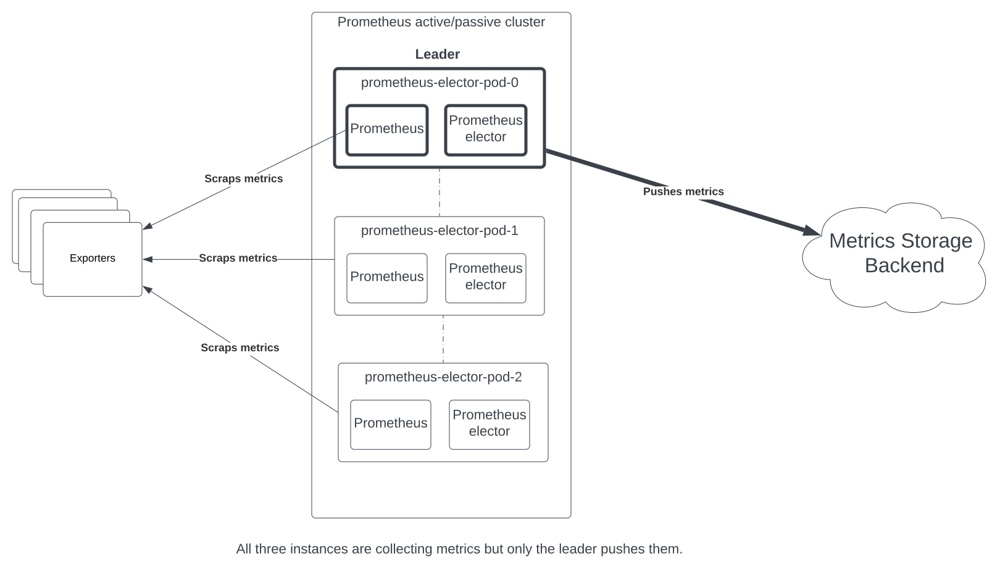
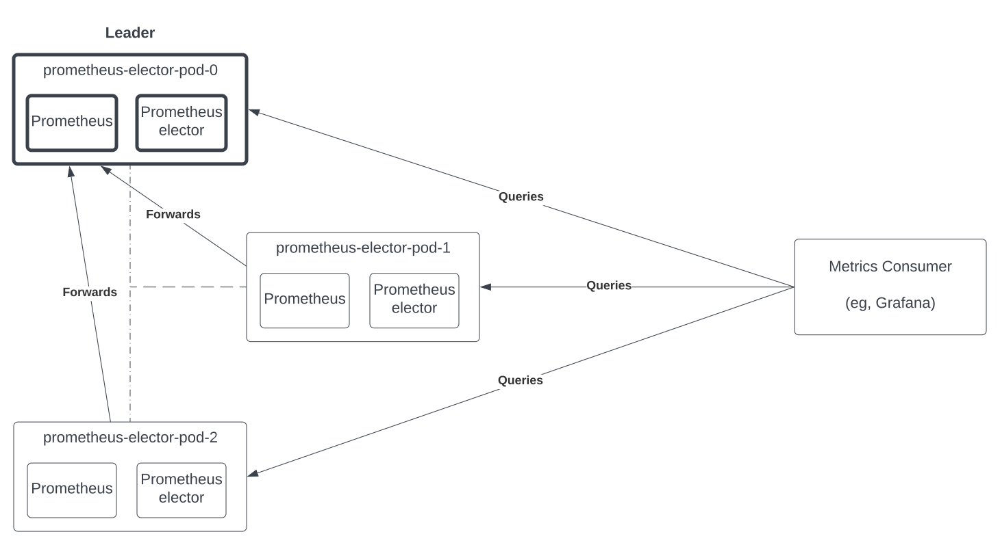

# prometheus-elector

`prometheus-elector` runs leader election across multiple [Prometheus](https://github.com/prometheus/prometheus) instances in a Kubernetes cluster using Kubernetes `Lease` objects. It provides two capabilities:

- **Election-Aware Configuration**: Ensures that only the currently elected leader applies specific configuration overrides (such as `remote_write` or `scrape_configs`), automatically updating the Prometheus configuration and triggering a reload on leadership changes.
- **Election-Aware Proxy**: Optionally acts as a reverse proxy that forwards incoming HTTP API requests to the currently elected leader instance.

The goal of `prometheus-elector` is to offer a simple, low-maintenance, active-passive HA fallback for Prometheus on Kubernetes when backend deduplication is not available.

## When to Use (and When Not to Use)

> [!IMPORTANT]
> **Active-active HA with backend deduplication is the recommended first choice.**
> If your backend supports **write-side deduplication** (such as [Grafana Mimir](https://grafana.com/oss/mimir/) or Cortex) or **read-side deduplication and merging** (such as [Thanos](https://thanos.io/) Querier or [Promxy](https://github.com/jacksontj/promxy)), prefer running standard active-active Prometheus replicas instead of `prometheus-elector`. Active-active HA avoids scrape, ingestion, and query gaps during failovers, restarts, and rolling upgrades.

`prometheus-elector` is intended as a **secondary option for edge cases** where active-active deduplication is not available or practical:

- **Remote-write backends without HA deduplication**: Any remote-write storage backend or custom receiver that does not support HA replica deduplication, or deployments where backend deduplication (such as in Mimir or Thanos) cannot be enabled or is not configured.
- **Active-passive failover without backend support**: When you want Kubernetes-native leader election so only one Prometheus (or Prometheus Agent) replica writes or serves as leader at a time, and you can accept brief gaps (seconds) during failover.

### What `prometheus-elector` Is Not

- **Not a replacement for backend deduplication**: Prefer write-side (Mimir/Cortex) or read-side (Thanos/Promxy) deduplication whenever your backend supports it.
- **Not horizontally scalable for cardinality**: Only one Prometheus instance acts as the leader at a time. Look into sharding or distributed storage backends (like Mimir or Thanos) to scale beyond a single instance.
- **Not zero-downtime or gap-free**: When the leading instance restarts, becomes unhealthy, or crashes, there is a short window (seconds, governed by lease timeouts and scrape intervals) before a standby replica takes over. In proxy mode, switching leaders does not merge missing history across replicas.
- **Not portable outside Kubernetes**: It assumes running on Kubernetes and relies on [Kubernetes leader election](https://kubernetes.io/blog/2016/01/simple-leader-election-with-kubernetes/) (`coordination.k8s.io/v1` `Lease` resources).

## Use Cases

### Active-Passive Prometheus Agent / Remote Write (Primary Use Case)

Prometheus (in [Agent Mode](https://prometheus.io/blog/2021/11/16/agent/) or server mode) is often used to push metrics via `remote_write` to a remote storage backend. While the backend itself may be highly available, you also want the collector side to tolerate pod restarts and node failures.

The standard approach is to run multiple active replicas pushing the same metrics and let the backend deduplicate them (write-side deduplication in Mimir/Cortex, or read-side deduplication in Thanos). However, **not all remote-write backends support HA deduplication** (for example, managed or general-purpose storage backends and custom remote-write receivers), or deduplication may not be configured.

In those cases, `prometheus-elector` lets you run multiple Prometheus replicas in Kubernetes while ensuring only the elected leader has `remote_write` enabled, failing over to another replica within seconds if the leader becomes unavailable.

Depending on your priorities, you can structure the configuration in two ways:

- **Warm standby (faster failover)**: Put `scrape_configs` under `follower` and `remote_write` under `leader` (as shown in the diagram below and in [`example/k8s/agent-values.yaml`](./example/k8s/agent-values.yaml)). All replicas keep scraping targets, while only the leader pushes samples.
- **Idle standby (lower resource and target load)**: Put both `scrape_configs` and `remote_write` under `leader` (keeping `follower` minimal, such as `global:` settings). Followers remain idle—avoiding duplicate scrape load on targets and saving CPU, memory, and network bandwidth—at the cost of a slightly longer failover while the new leader reloads and starts scraping.

Trade-offs:

- Enables collector-side failover without requiring deduplication support on the remote backend.
- Avoids duplicate writes in normal operation (note that brief gaps occur during failover, and brief overlaps are still possible around abrupt network partitions or in-flight flushes depending on lease timing).



You can find an example configuration for this use case in [`example/k8s/agent-values.yaml`](./example/k8s/agent-values.yaml).

#### Running the Agent Example

You need [ko](https://github.com/ko-build/ko), `kubectl`, [k3d](https://github.com/k3d-io/k3d), `docker`, and `helm` installed. Make sure `prometheus-elector-registry.localhost` resolves to `127.0.0.1` by adding an entry to `/etc/hosts`.

Then run `make run_agent_example`. This command:

- Creates a local `k3d` cluster.
- Installs a storage-backend Prometheus instance (in the `storage` namespace) configured to receive metrics via the `remote_write` API.
- Installs a StatefulSet running two replicas of `prometheus-elector` and Prometheus in agent mode, where only the elected leader pushes metrics.

### Active-Passive Prometheus with Leader Proxy

Running multiple independent Prometheus instances behind a standard load balancer causes slightly divergent query results across replicas. **For HA querying without data gaps, running active-active Prometheus behind a deduplicating/merging query layer (such as [Thanos Querier](https://thanos.io/) or [Promxy](https://github.com/jacksontj/promxy)) is strongly recommended.**

For simpler edge cases where a merging query layer is not desired, `prometheus-elector` embeds an optional reverse proxy that forwards all incoming HTTP requests to the currently elected leader. While this does not provide load balancing or cross-replica series merging—so failovers or leader restarts can still leave visible gaps in query results—it ensures consistent reads from a single replica regardless of which pod receives the request.



You can find an example configuration for this use case in [`example/k8s/ha-values.yaml`](./example/k8s/ha-values.yaml).

#### Running the Proxy Example

You need [ko](https://github.com/ko-build/ko), `kubectl`, [k3d](https://github.com/k3d-io/k3d), `docker`, and `helm` installed. Make sure `prometheus-elector-registry.localhost` resolves to `127.0.0.1` by adding an entry to `/etc/hosts`.

Then run `make run_proxy_example`. This command:

- Creates a local `k3d` cluster.
- Installs a StatefulSet running two replicas of `prometheus-elector` and Prometheus.

From there, port-forward to the leader service (`kubectl port-forward service/prometheus-elector-dev-leader 9095:80`) and query the Prometheus API through port `9095`.

## How It Works

`prometheus-elector` runs as a sidecar container alongside Prometheus—similar to [`configmap-reload`](https://github.com/jimmidyson/configmap-reload)—participating in [Kubernetes leader election](https://kubernetes.io/blog/2016/01/simple-leader-election-with-kubernetes/), rendering the appropriate Prometheus configuration file, triggering Prometheus reloads via its HTTP lifecycle API (`--web.enable-lifecycle`), and optionally serving the leader reverse proxy.

An init container running `prometheus-elector -init` can be used to render the initial `follower` configuration before Prometheus starts.

### Election-Aware Configuration

`prometheus-elector` reads a YAML configuration file with two top-level sections, both following the standard Prometheus configuration schema:

- `follower` (required): The base Prometheus configuration, always applied while the replica is running.
- `leader` (optional): Overrides merged into `follower` when the replica is elected leader (matching map keys are overridden and slices are appended).

When a replica becomes leader, `prometheus-elector` writes the merged `follower` + `leader` configuration to `-output` and notifies Prometheus to reload via `-notify-http-url` (typically `http://127.0.0.1:9090/-/reload`). When it loses leadership, `prometheus-elector` writes only the `follower` configuration and reloads Prometheus again.

Here is an example that enables `remote_write` only on the elected leader (warm standby):

```yaml
# Base configuration applied when the instance is a follower.
follower:
  scrape_configs:
    - job_name: 'some-job'
      scrape_interval: 5s
      static_configs:
        - targets: ['localhost:8080']

# Overrides merged into the follower configuration when the instance is leader.
leader:
  remote_write:
    - url: https://remote-write.example.com/api/v1/write
```

To keep followers idle instead (avoiding duplicate scraping), move `scrape_configs` under `leader` and keep a minimal `follower` block (for example `follower: {}`, or shared top-level settings like `global:`).

### Election-Aware Proxy

When `-api-proxy-enabled` is set, `prometheus-elector` exposes a reverse proxy that forwards incoming HTTP calls to the leading Prometheus instance.

This relies on two assumptions:

- The replica's member ID is the pod name (read from the `POD_NAME` environment variable, falling back to the container hostname).
- `<member_id>.<service_name>` resolves via cluster DNS, which is standard for Kubernetes StatefulSets backed by a headless Service.

### Monitoring the Local Prometheus

`prometheus-elector` monitors its local Prometheus instance to avoid holding leadership when Prometheus is not ready or unhealthy:

- On startup, it waits for the local Prometheus instance to become ready (`-readiness-http-url`) before joining the leader election.
- While running, it periodically probes local health (`-healthcheck-http-url`), automatically leaving the election if Prometheus becomes unhealthy and rejoining once it recovers.

## Installing

You can find a [Helm chart](./helm) in this repository, along with example values for [active-passive agent mode](./example/k8s/agent-values.yaml) and [leader proxy mode](./example/k8s/ha-values.yaml).

## API Reference

When `-api-proxy-enabled` is set, all HTTP requests received on `-api-listen-address` (default `:9095`) are forwarded to the leader Prometheus instance on port `9090` by default, except for the built-in elector endpoints:

- `/_elector/healthz`: Health check endpoint (`200 OK`).
- `/_elector/leader`: Returns JSON election status (`{"is_leader": bool, "current_leader": string}`).
- `/_elector/metrics`: Prometheus metrics endpoint.

## Configuration Reference

The election member ID is read from the `POD_NAME` environment variable and falls back to the container hostname if unset.

```text
  -api-listen-address string
        HTTP listen address for the API. (default ":9095")
  -api-proxy-enabled
        Turn on leader proxy on the API
  -api-proxy-prometheus-local-port uint
        Listening port of the local prometheus instance (default 9090)
  -api-proxy-prometheus-remote-port uint
        Listening port of any remote prometheus instance (default 9090)
  -api-proxy-prometheus-service-name string
        Name of the statefulset headless service
  -api-shutdown-grace-delay duration
        Grace delay to apply when shutting down the API server (default 15s)
  -config string
        Path of the prometheus-elector configuration
  -healthcheck-failure-threshold int
        Amount of consecutives failures to consider Prometheus unhealthy (default 3)
  -healthcheck-http-url string
        URL to the Prometheus health endpoint
  -healthcheck-period duration
        Healthcheck period (default 5s)
  -healthcheck-success-threshold int
        Amount of consecutives success to consider Prometheus healthy (default 3)
  -healthcheck-timeout duration
        HTTP timeout for healthchecks (default 2s)
  -init
        Only init the prometheus config file
  -kubeconfig string
        Path to a kubeconfig. Only required if out-of-cluster.
  -lease-duration duration
        Duration of a lease, client wait the full duration of a lease before trying to take it over (default 10s)
  -lease-name string
        Name of lease resource
  -lease-namespace string
        Name of lease resource namespace
  -lease-renew-deadline duration
        Maximum duration spent trying to renew the lease (default 8s)
  -lease-retry-period duration
        Delay between two attempts of taking/renewing the lease (default 2s)
  -notify-http-method string
        HTTP method to use when sending the reload config request (default "POST")
  -notify-http-url string
        URL to the reload configuration endpoint
  -notify-retry-delay duration
        Delay between two notify retries. (default 10s)
  -notify-retry-max-attempts int
        How many retries for configuration update (default 5)
  -notify-timeout duration
        HTTP timeout for notify retries. (default 2s)
  -output string
        Path to write the Prometheus configuration
  -readiness-http-url string
        URL to the Prometheus ready endpoint
  -readiness-poll-period duration
        Poll period prometheus readiness check (default 5s)
  -readiness-timeout duration
        HTTP timeout for readiness calls (default 2s)
  -runtime-metrics
        Export go runtime metrics
```

## License

Apache License 2.0, see [LICENSE](./LICENSE).
